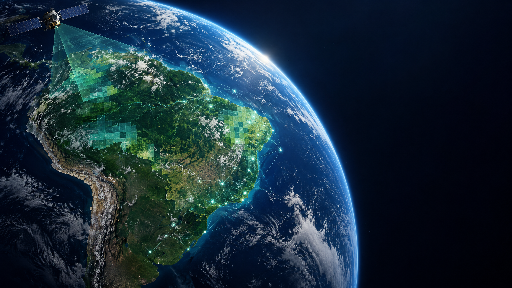
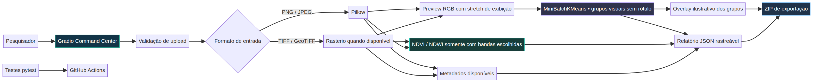
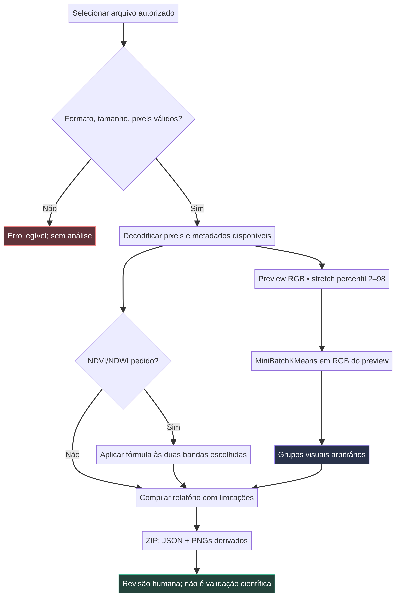
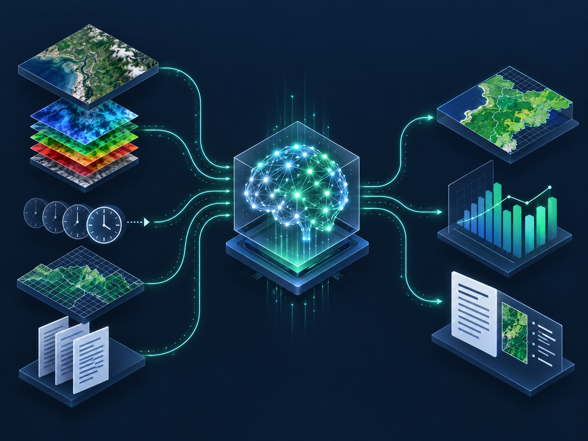
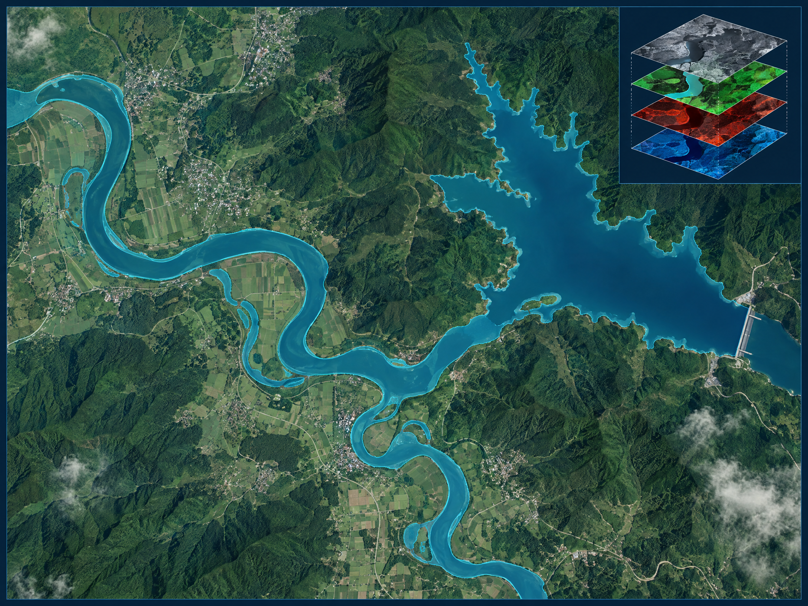
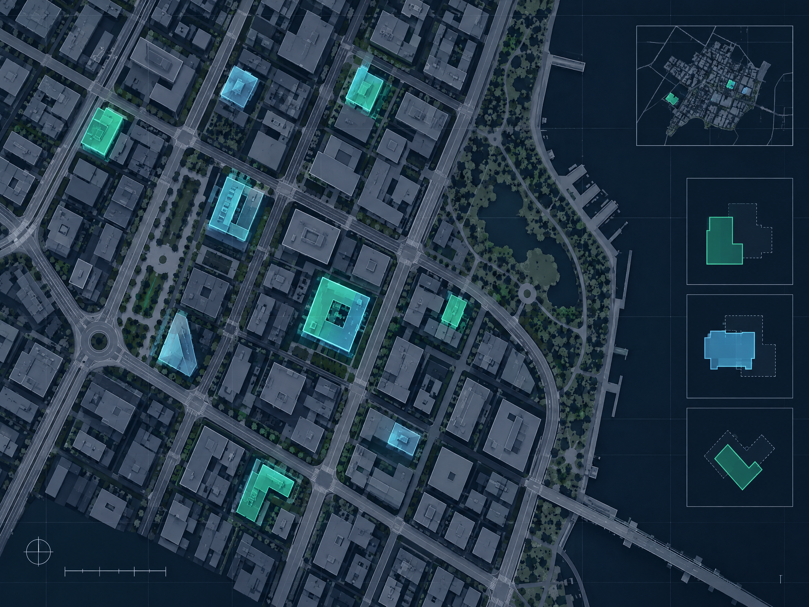
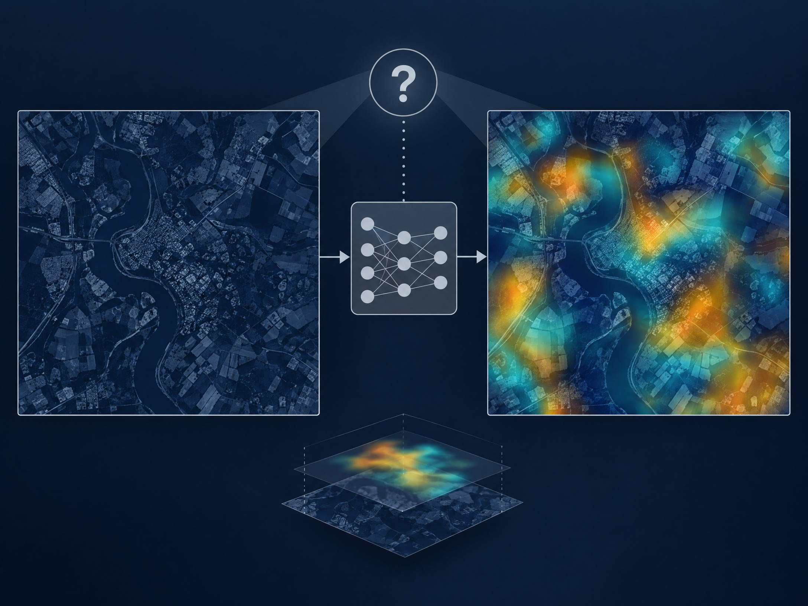

# AURORA GEOINTELLIGENCE XAI

### Sovereign Multimodal Earth Intelligence



**Uma iniciativa de pesquisa e desenvolvimento da Impulso Digital Soluções em I.A. Ltda.** Desenvolvido no Brasil. Fundador e responsável técnico, conforme informado para este projeto: Felipe Marcos de Abreu Aquino — Founder, CEO & Chief AI Architect.

> **Estado do projeto:** MVP experimental v0.1.0. Demonstra inspeção geoespacial, agrupamento visual reprodutível e índices espectrais opcionais. Ainda não inclui modelo treinado ou pesos pré-treinados especializados em sensoriamento remoto, nem integração STAR.VISION/OSE. Não declara acurácia científica.

## Problema e proposta

Pesquisadores precisam inspecionar imagens e seus metadados sem esconder pré-processamentos ou limitações. O MVP oferece um caminho local e de baixo custo para carregar PNG, JPEG, TIFF ou GeoTIFF, examinar metadados disponíveis, produzir agrupamentos de cores e calcular NDVI/NDWI somente quando as bandas forem informadas pelo usuário. Cada execução exporta um relatório JSON rastreável.



## Funcionalidades nesta versão

- Upload com restrições de formato, tamanho e dimensões.
- Leitura de metadados geoespaciais TIFF quando disponível via Rasterio.
- Visualização RGB exploratória com stretch percentil 2–98.
- Agrupamento MiniBatchKMeans determinístico (2–8 grupos) e resumo de cores/participação.
- NDVI/NDWI opcional, com índices de bandas selecionados pelo usuário.
- Exportação ZIP com `analysis_report.json`, máscara de grupos, overlay e mapa de índice (quando solicitado).
- Relatório com versão dos parâmetros, metadados disponíveis e limitações; sem métricas de desempenho inventadas.

### Importante sobre interpretações

Os grupos não são água, vegetação, edificações ou classes de cobertura do solo. NDVI/NDWI dependem das bandas corretas e de dados adequadamente calibrados; valores não comprovam qualidade da água, poluição ou condição ambiental. Não há máscaras de referência anotadas e, portanto, não há precisão, recall, F1 ou IoU validados. Overlays não são Grad-CAM nem prova de causalidade.

## Demonstração

Instale Python 3.11 ou superior e execute:

```bash
python -m venv .venv
source .venv/bin/activate  # Windows: .venv\\Scripts\\activate
pip install -r requirements.txt
python app.py
```

Abra `http://localhost:7860`, envie imagem autorizada e pressione **Executar análise**. Para avaliação sem dados reais, use [`examples/synthetic_scene.png`](examples/synthetic_scene.png), que é uma composição artificial criada para teste e não representa local ou imagem de satélite real.

Para executar os testes:

```bash
pytest -q
```

## Arquitetura e materiais

A aplicação Gradio está em `app.py`. O núcleo funcional está em `src/aurora_geointelligence/core.py`. Diagramas técnicos determinísticos e sua fonte Mermaid ficam em `assets/`. A documentação bilíngue está em `docs/`, incluindo metodologia, validação, governança, integração STAR.VISION, limitações e anterioridade.











As ilustrações de água, urbanização, percepção e explicabilidade foram geradas para o projeto; não representam cenas observadas, resultados experimentais ou imagens da STAR.VISION. A arte de capa e divulgação está em `assets/presentation-cover.png` e `assets/social-promo.png`.

## Módulos previstos

AURORA CORE e GEOINTELLIGENCE ENGINE estão representados pelo núcleo experimental deste MVP. SENTINELA DAS ÁGUAS, YBYRÁ ECOINTELLIGENCE, AURORA URBAN INTELLIGENCE e CANÁRIO SOVEREIGN X permanecem frentes de evolução; as ilustrações não significam que já existam modelos especializados desses módulos.

## STAR.VISION OSE

O programa é citado somente como contexto informado pelo fundador. Este repositório não declara parceria comercial, patrocínio, certificação, endosso ou desenvolvimento conjunto. Nenhuma conexão, API ou dado STAR.VISION foi usada. A importação atual é manual de arquivos autorizados; consulte [`docs/STARVISION_INTEGRATION.md`](docs/STARVISION_INTEGRATION.md).

## Testes e validação

Os 11 testes locais passaram em Python 3.12; o dashboard também respondeu ao smoke test HTTP. O arquivo de workflow está preservado em [`docs/GITHUB_ACTIONS_WORKFLOW.yml`](docs/GITHUB_ACTIONS_WORKFLOW.yml), mas ainda não está ativo no GitHub: a permissão atual de publicação não autoriza criar arquivos em `.github/workflows/`. Um mantenedor pode ativá-lo após conceder essa permissão pelo fluxo oficial do GitHub. A demonstração funcional é distinta de uma avaliação experimental e de validação científica independente; consulte [`docs/VALIDATION_PROTOCOL.md`](docs/VALIDATION_PROTOCOL.md).

## Roadmap

Ver [`docs/ROADMAP.md`](docs/ROADMAP.md) para a sequência de evolução. A inclusão de pesos públicos para sensoriamento remoto, APIs externas ou dados especializados fica condicionada à verificação de licença, capacidade de CPU, documentação oficial e direitos de uso.

## Anterioridade, limitações e referências

A matriz comparativa em português está em [`docs/RESEARCH_NOVELTY.md`](docs/RESEARCH_NOVELTY.md), com síntese em inglês em [`docs/RESEARCH_NOVELTY.en.md`](docs/RESEARCH_NOVELTY.en.md). O projeto não afirma ser o primeiro do mundo, inédito mundial ou patenteável. Veja também [`docs/LIMITATIONS.md`](docs/LIMITATIONS.md), [`docs/SCIENTIFIC_METHODOLOGY.md`](docs/SCIENTIFIC_METHODOLOGY.md) e [`docs/DATA_GOVERNANCE.md`](docs/DATA_GOVERNANCE.md).

## Segurança, licença e citação

Não envie material sigiloso a uma implantação pública. Consulte [`docs/SECURITY.md`](docs/SECURITY.md). O código original está sob Apache-2.0; dependências mantêm suas próprias licenças. Não redistribua dados ou imagens de terceiros sem autorização. Veja [`CITATION.cff`](CITATION.cff) para citação de software; não há publicação ou DOI informado.

## English

AURORA GEOINTELLIGENCE XAI is an experimental Brazilian research MVP from Impulso Digital Soluções em I.A. Ltda. It provides image inspection, deterministic MiniBatchKMeans visual grouping and optional user-selected NDVI/NDWI calculations for PNG, JPEG, TIFF and GeoTIFF. Each run exports an auditable JSON report and derived PNGs.

Clusters are not semantic land-cover labels. Indices do not prove environmental conditions. The release contains no remote-sensing pretrained weights, annotated benchmark, validated accuracy claims, STAR.VISION data, or STAR.VISION/OSE integration. Its current contribution is an explicit, reproducible workflow; no worldwide novelty or patentability claim is made. See the Portuguese documentation above and source files for installation, methodology, validation, data governance, limitations and roadmap.

## Referências

As fontes da matriz de anterioridade ficarão registradas com URLs verificadas em [`docs/RESEARCH_NOVELTY.md`](docs/RESEARCH_NOVELTY.md). A documentação não inventa resultados, publicações, certificações ou parcerias.
