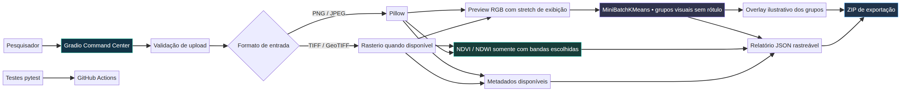

# AURORA GEOINTELLIGENCE XAI

### Inteligência da Terra. Código aberto. Evidência antes de promessa.


**Uma iniciativa de pesquisa e desenvolvimento da Impulso Digital Soluções em I.A. Ltda.** Desenvolvido no Brasil. Fundador e responsável técnico informado para o projeto: Felipe Marcos de Abreu Aquino — Founder, CEO & Chief AI Architect.

> **Estado público:** MVP experimental v0.1.0, executável em CPU. O núcleo atual inspeciona imagens, registra metadados disponíveis, agrupa pixels por cor de forma reprodutível e calcula índices espectrais opcionais quando as bandas são informadas pela pessoa usuária. **Não é ainda um modelo geoespacial treinado, não usa PyTorch e não reivindica acurácia científica ou explicabilidade de um modelo aprendido.**

---

## Manifesto de ruptura e soberania tecnológica

> **Soberania tecnológica não é slogan de gabinete. É capacidade instalada, infraestrutura acessível, financiamento, governança, continuidade e engenharia que qualquer pessoa possa auditar.**

O Brasil não terá soberania digital apenas porque ela aparece em discursos, planos, eventos ou apresentações. Quando a ambição anunciada em Brasília — inclusive no debate público associado ao MCTI e à SETAD — não se converte em caminhos materiais e acessíveis para quem pesquisa e constrói fora dos círculos consolidados, há uma distância política entre a promessa e a capacidade real.

Este projeto registra, como **posição e experiência relatada por seus autores**, o custo dessa distância: portas difíceis de abrir, pouca previsibilidade e silêncio burocrático diante de quem tenta transformar pesquisa independente em infraestrutura. É uma crítica institucional e programática; não é relatório oficial, não imputa ilegalidade a uma pessoa específica e não afirma que qualquer órgão tenha endossado ou participado deste projeto. O ponto é simples: **a ausência de resposta administrativa não mede o valor da engenharia — mas pode desperdiçar tempo, talento e capacidade nacional.**

A Aurora escolhe responder com código, limites explícitos, documentação e testes reproduzíveis. Não pedimos que um gabinete declare este trabalho soberano. Pedimos que engenheiros, pesquisadores, financiadores e instituições o examinem pelo que está publicado — e que cobrem de qualquer política de soberania os meios concretos para que projetos independentes possam ser construídos, avaliados e sustentados.

### Ambição global, evidência local

A missão é desenvolver inteligência geoespacial explicável e auditável para apoiar transparência, auditoria e justiça socioambiental. Essa ambição é estratégica e global; a versão disponível, porém, é um MVP de exploração visual. **Nossa meta é disputar o mesmo padrão de exigência técnica e científica dos principais centros de Deep Tech do mundo — não alegar equivalência de desempenho antes de modelos, benchmarks e validação independente que a demonstrem.**

A regra editorial deste repositório é deliberada: separar o que roda hoje do que ainda é pesquisa, hipótese ou roadmap. Essa honestidade não diminui a ambição; é a condição para que ela possa ser levada a sério.

---

## O que existe nesta versão

A aplicação oferece um caminho local e de baixo custo para inspecionar arquivos raster, visualizar seus dados e registrar cada execução. Não há treinamento de modelos nesta versão.

| Capacidade | Implementação atual | Limite que importa |
|---|---|---|
| Entrada | PNG, JPEG, TIFF e GeoTIFF; até 100 MB e 50 milhões de pixels | O arquivo é enviado manualmente; não há busca automática em catálogos orbitais. |
| Metadados | Rasterio lê CRS, limites, resolução, tags e no-data de TIFF/GeoTIFF quando disponíveis | Metadados ausentes não são inferidos nem completados pelo sistema. |
| Pré-visualização | RGB das três primeiras bandas (ou banda única), stretch percentil 2–98, lado máximo de 768 px | O stretch é visual; não é calibração radiométrica. |
| Agrupamento | scikit-learn `MiniBatchKMeans`, 2–8 grupos, `random_state=42` | Agrupa cores do preview; não identifica classes semânticas de cobertura do solo. |
| Índices | NDVI/NDWI opcional com posições de bandas informadas pela pessoa usuária | A ferramenta não verifica sensor, comprimento de onda ou calibração. Resultado não comprova condição ambiental. |
| Saída | Imagens derivadas e ZIP com `analysis_report.json`, parâmetros, metadados e limitações | Relatórios tornam o processamento inspecionável; não equivalem a validação científica. |



### XAI: o que o nome significa — e o que não significa

Neste MVP, transparência significa expor as etapas, parâmetros, metadados e ressalvas do processamento. A máscara e o overlay mostram onde os grupos visuais aparecem na imagem; **não são Grad-CAM, explicação causal nem evidência de por que um modelo treinado tomou uma decisão**, porque este repositório ainda não contém tal modelo. Os grupos não são água, vegetação, edificações ou classes de uso do solo.

### PyTorch e modelos geoespaciais: próximos passos, não capacidade atual

O código funcional desta versão usa NumPy, Pillow, Rasterio e scikit-learn; **PyTorch não consta nas dependências nem no motor atual**. A avaliação de modelos pré-treinados e de componentes do ecossistema PyTorch/TorchGeo está no roadmap. Uma integração só será anunciada depois de verificados licença, sensores e bandas, custo de inferência, testes e avaliação documentada. Até lá, o agrupamento atual permanece identificado como baseline exploratório — não como motor de Deep Learning.

---

## Dossiê do ecossistema Aurora

Os projetos abaixo compartilham uma agenda de pesquisa em soberania e infraestrutura, mas não formam uma plataforma integrada em produção. Cada repositório tem estágio, escopo e evidência próprios.

### 1. Aurora Geointelligence XAI — Oráculo X-37

**Objetivo:** inspeção geoespacial reproduzível, registro de metadados e processamento transparente de imagens, como base para futuras ferramentas de auditoria e análise ambiental.

**Hoje:** MVP Gradio/Python em CPU; leitura de imagens e metadados, agrupamento visual determinístico, índices espectrais opcionais e relatório JSON. O [Oráculo X-37](https://github.com/felipetjmg1-bit/oraculo-x37) é um repositório relacionado de classificação/regressão e ferramentas determinísticas de análise explicável; não deve ser confundido com um modelo geoespacial treinado integrado a este MVP.

**Ainda não existe aqui:** classificador supervisionado de sensoriamento remoto, pesos especializados, XAI de modelo validada, benchmark anotado, análise temporal ou integração com STAR.VISION/OSE. Consulte [`docs/LIMITATIONS.md`](docs/LIMITATIONS.md) e [`docs/ROADMAP.md`](docs/ROADMAP.md).

### 2. Arquitetura de Integração Soberana — Aurora DREX

**Objetivo de pesquisa:** desenhar uma camada de interoperabilidade auditável para fluxos de dados e serviços, com atenção a governança, rastreabilidade, controle e dependências tecnológicas.

**Estágio:** direção arquitetural/proposta do ecossistema, não integração operacional com o Drex, com o Banco Central ou com qualquer rede financeira. Este repositório não declara parceria, autorização, certificação ou participação em piloto. Demonstrações de compromissos e provas de inclusão Merkle em outros projetos são componentes didáticos; não constituem integração ao Drex nem prova zero-knowledge.

### 3. Persistência de longo prazo — Projeto Cristal / Quartzo 5D

**Objetivo de pesquisa:** explorar conceitos de preservação e armazenamento de longo prazo.

**Artefatos públicos relacionados:** [Cristal de Quartzo Aurora — API demonstrativa](https://github.com/felipetjmg1-bit/cristal-quartzo-aurora) e [Cristal 5D — simulador web](https://github.com/felipetjmg1-bit/CRISTAL-5D-V.4.0-MODULO-1).

**Estágio verificável:** a API simula operações de ingestão, recuperação e status; a aplicação web visualiza etapas conceituais. Os repositórios não demonstram gravação/leitura óptica, armazenamento físico persistente em cristal ou integração real com Drex. “Quartzo 5D” identifica uma linha de pesquisa e prototipagem, não uma capacidade de armazenamento físico já disponível.

### 4. Biocomputação e criptografia — Projeto Ybyrá

**Objetivo de pesquisa:** explorar, em software educacional, ideias de codificação inspirada em DNA, análise explicável simples e conceitos de criptografia quântica.

**Artefato:** [Projeto Ybyrá — Árvore-Mãe](https://github.com/felipetjmg1-bit/projeto-ybyra).

**Estágio verificável:** protótipo de software com codificação digital inspirada em DNA, módulos simples de XAI, dados sintéticos e simulação clássica de etapas do BB84, além de demonstração de inclusão Merkle. Não há hardware biológico, computação em tecido vivo, enlace quântico/QKD real, integração Drex ou validação de segurança para produção. As demonstrações não devem ser tratadas como sistemas implantados.

---

## Chamado global: código aberto, revisão independente, cooperação real

À comunidade internacional de desenvolvedores, laboratórios de Deep Tech, fundos e investidores de tecnologia, pesquisadores de observação da Terra e parceiros estratégicos: **a engenharia soberana brasileira existe como trabalho concreto, código público e protótipos executáveis — e deve ser julgada com rigor técnico, não por sua proximidade a um gabinete.**

Convidamos pessoas e instituições ligadas a iniciativas de cooperação Brasil–Europa, à comunidade MLCommons e a redes internacionais de IA e geotecnologia a revisar o código, propor benchmarks reproduzíveis, apontar falhas, discutir licenças e construir cooperação com escopo e responsabilidades claros. Esta menção é um convite aberto: **não declara afiliação, endosso, parceria, participação em programa ou validação por MLCommons, União Europeia ou qualquer entidade.**

Não estamos pedindo validação por deferência. Estamos abrindo o trabalho à crítica verificável: inspeção de código, reprodução dos resultados, dados com licença clara, métricas adequadas e avaliação independente. Se a soberania tecnológica significa alguma coisa, ela precisa sobreviver a esse exame — e também precisa de condições materiais para que quem constrói consiga continuar.

**Para contribuir:** abra uma issue com uma pergunta técnica ou proposta reproduzível, ou envie um pull request. Para colaboração institucional ou investimento, comece por uma issue pública que descreva escopo, recursos, governança de dados e critérios de validação. Não envie dados sigilosos, pessoais ou sem autorização.

---

## Executar localmente

Requer Python 3.11 ou superior. A execução é CPU-first e não exige GPU, token, banco de dados ou serviço pago.

```bash
python -m venv .venv
source .venv/bin/activate  # Windows: .venv\Scripts\activate
pip install -r requirements.txt
python app.py
```

Acesse `http://localhost:7860`, carregue uma imagem autorizada e selecione **Executar análise**. Para uma demonstração sem dados reais, use [`examples/synthetic_scene.png`](examples/synthetic_scene.png), uma composição artificial que não representa local ou imagem de satélite real.

Para rodar os testes, com as dependências instaladas:

```bash
pytest -q
```

A documentação registra 11 testes locais e um smoke test HTTP em 13/11/2026; isso não substitui CI ativo, benchmark geoespacial ou validação científica independente. O workflow de referência está em [`docs/GITHUB_ACTIONS_WORKFLOW.yml`](docs/GITHUB_ACTIONS_WORKFLOW.yml), mas não está ativo em `.github/workflows/` neste repositório.

---

## Documentação, governança e limites

- [Arquitetura](docs/ARCHITECTURE.md) · [Especificação técnica](docs/TECHNICAL_SPECIFICATION.md) · [Resumo](docs/ABSTRACT.md)
- [Metodologia científica](docs/SCIENTIFIC_METHODOLOGY.md) · [Protocolo de validação](docs/VALIDATION_PROTOCOL.md) · [Limitações](docs/LIMITATIONS.md)
- [Governança de dados](docs/DATA_GOVERNANCE.md) · [Segurança](docs/SECURITY.md) · [Roteiro](docs/ROADMAP.md)
- [Matriz de anterioridade e referências](docs/RESEARCH_NOVELTY.md) · [Research novelty (English)](docs/RESEARCH_NOVELTY.en.md)
- [Contribuição](docs/CONTRIBUTING.md) · [Citação](CITATION.cff)

Não envie material sigiloso a uma implantação pública. Os direitos sobre dados e imagens de terceiros permanecem com seus titulares. O código original está sob Apache-2.0; dependências mantêm suas próprias licenças. Não há publicação científica, DOI, certificação ou parceria institucional declarada neste repositório.

---

## English — project brief

**AURORA GEOINTELLIGENCE XAI** is an experimental Brazilian research MVP for auditable, CPU-first inspection of geospatial imagery. The current implementation uses Gradio, NumPy, Rasterio, Pillow and scikit-learn MiniBatchKMeans; it reads available raster metadata, creates a display preview, groups preview pixels by color, optionally computes user-selected spectral indices, and exports a traceable JSON report.

This release **does not use PyTorch, contain remote-sensing pretrained weights, provide validated model-level XAI, or claim scientific accuracy**. Clusters are not land-cover classes; optional NDVI/NDWI values depend on correct band selection and calibrated data. The ecosystem sections above link to related Aurora DREX, Cristal/Quartz 5D and Ybyrá projects while explicitly distinguishing proposals and software simulations from operational integrations or physical systems.

Our political position is direct: technological sovereignty requires sustained infrastructure and practical support, not slogans alone. Our global ambition is to meet world-class standards of engineering and scientific scrutiny; we do not claim equivalent performance without independent evidence. We welcome code review, reproducible benchmarks and responsible cooperation from international developers, Deep Tech researchers and strategic partners. References to MLCommons and Brazil–Europe cooperation are invitations, not claims of affiliation or endorsement.

## Referências e declarações

Este README distingue capacidades demonstráveis, relatos dos autores e objetivos de pesquisa. As menções institucionais são contextuais e não significam apoio, participação, financiamento ou parceria. A matriz de anterioridade registra fontes em [`docs/RESEARCH_NOVELTY.md`](docs/RESEARCH_NOVELTY.md); o repositório não afirma ser o primeiro do mundo nem reivindica desempenho ou patenteabilidade não demonstrados.
