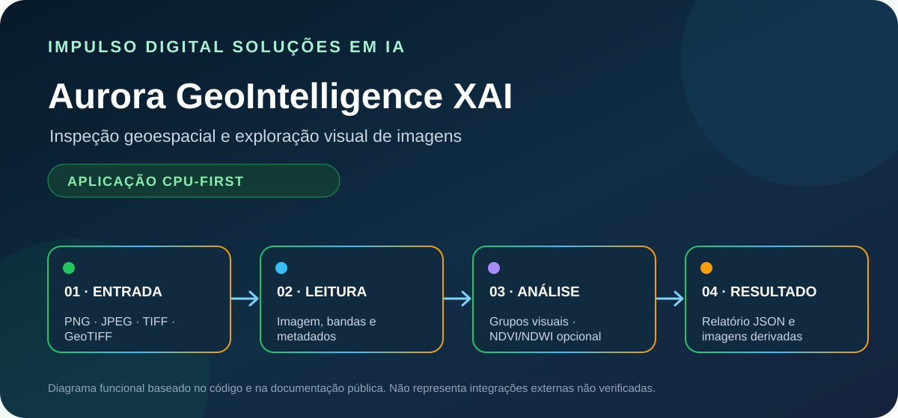

# Aurora GeoIntelligence XAI


<p align="center">
  
</p>


**[MVP experimental]** Aplicação Python com interface Gradio para inspeção de imagens e exploração geoespacial em CPU. Não é um sistema de produção, ferramenta pericial ou classificador semântico de cobertura do solo.

## Problema e objetivo

O projeto oferece um fluxo local e reproduzível para explorar imagens PNG, JPEG, TIFF e GeoTIFF, visualizar grupos de cores e registrar parâmetros e metadados disponíveis. É uma base de pesquisa para geoinformação e observação da Terra, com atenção a processamento acessível e transparência técnica no contexto brasileiro.

## O que está implementado

- Interface Gradio em `app.py`.
- Núcleo de processamento em `src/aurora_geointelligence/core.py`.
- Leitura de imagens e metadados TIFF/GeoTIFF quando Rasterio consegue interpretar o arquivo.
- Agrupamento visual não supervisionado com `MiniBatchKMeans` do scikit-learn.
- Cálculo opcional de NDVI/NDWI somente quando a pessoa usuária seleciona explicitamente as bandas.
- Relatório JSON e pacote de resultados com imagens derivadas.
- Testes existentes em `tests/test_core.py`.

**CPU-first:** as dependências e o código desta versão não usam PyTorch nem exigem GPU.

## Como executar

Requisitos: Python 3.11 e dependências do sistema exigidas pelo Rasterio/GDAL conforme a plataforma.

```bash
git clone https://github.com/felipetjmg1-bit/aurora-geointelligence-xai.git
cd aurora-geointelligence-xai
python -m venv .venv
source .venv/bin/activate  # Windows: .venv\Scripts\activate
python -m pip install --upgrade pip
pip install -r requirements.txt
python app.py
```

Abra o endereço local informado pelo Gradio (por padrão, porta 7860). A aplicação lê a variável opcional `PORT`; não exige chave de API para o fluxo local.

## Exemplo prático

1. Abra a interface e envie um GeoTIFF ou uma imagem PNG/JPEG.
2. Mantenha o índice espectral em “Nenhum” para imagens RGB comuns.
3. Escolha entre 2 e 8 grupos visuais e execute a análise.
4. Baixe o pacote e examine `analysis_report.json` e as imagens derivadas.

Exemplo de configuração espectral: para NDVI, informe A=NIR e B=vermelho; para NDWI, A=verde e B=SWIR. A aplicação não identifica essas bandas automaticamente.

## Estrutura

- `app.py`: interface Gradio.
- `src/aurora_geointelligence/`: núcleo de análise.
- `tests/`: testes automatizados existentes.
- `docs/`: arquitetura, governança de dados, segurança, limitações e protocolo de validação.
- `examples/`: material de demonstração.
- `assets/`: diagramas e imagens do projeto.

## Segurança, privacidade e limitações

- O processamento ocorre no processo da aplicação; não envie dados pessoais, sigilosos ou imagens sem autorização.
- Não há autenticação de usuários ou controle de acesso multiusuário implementado nesta interface.
- O agrupamento opera sobre cores do preview; não equivale a classificação de vegetação, água, uso do solo ou objetos.
- NDVI/NDWI dependem da seleção correta de bandas, sensor e calibração; a semântica não é inferida.
- Relatórios rastreáveis não são cadeia de custódia criptográfica.
- Não há validação científica independente, benchmark anotado ou garantia de acurácia.
- Para dados sujeitos à LGPD, use dados anonimizados ou sintéticos, minimize retenção e estabeleça base legal e controles organizacionais antes de qualquer uso real.

## Dependências e validação

As dependências estão declaradas em `requirements.txt` com faixas de versão, não em lockfile integralmente fixado. Não alteramos essas versões nesta PR para evitar incompatibilidades não testadas. Execute `pytest -q` localmente para validar o ambiente após instalar as dependências.

## Licença

Apache-2.0. Consulte [LICENSE](LICENSE).

## Responsável

Impulso Digital Soluções em IA · [GitHub](https://github.com/felipetjmg1-bit)


## Validação e desenvolvimento

- [Plano de validação e critérios de release](docs/VALIDATION-PLAN.md)
- [Workflow CPU CI](.github/workflows/portfolio-ci.yml)
