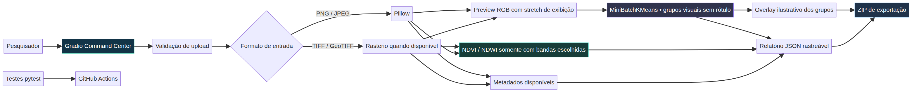

# Architecture / Arquitetura

## Português

O MVP separa interface, núcleo analítico e dados. `app.py` apresenta o Command Center em Gradio. `src/aurora_geointelligence/core.py` valida arquivos, lê pixels/metadados, produz preview, executa agrupamento visual, calcula índice espectral opcional e empacota resultados. O diretório `tests/` exercita funções do núcleo sem depender de serviços externos.

A entrada é um arquivo enviado manualmente pelo usuário. A leitura TIFF/GeoTIFF consulta metadados via Rasterio; a leitura de outras imagens usa Pillow. A camada de visualização normaliza somente o preview. MiniBatchKMeans recebe pixels RGB dessa visualização. NDVI/NDWI recebe bandas originais quando o usuário define seus índices. Relatório JSON e imagens resultantes são exportados em ZIP. Não há banco, processamento remoto, treinamento, pesos pré-treinados, autenticação, telemetria, aquisição automática ou integração STAR.VISION/OSE nesta versão.

Os módulos de produto descritos na missão (Sentinela das Águas, YBYRÁ, Urban Intelligence e Canário Sovereign X) são áreas futuras; ainda não existem como modelos especializados. As imagens de água/cidade são ilustrações conceituais, não dados observados. Uma visualização overlay explica somente como os grupos se sobrepõem à imagem; não é Grad-CAM nem evidência de causalidade.

## English

The MVP separates interface, analysis core and data. `app.py` serves the Gradio Command Center. `src/aurora_geointelligence/core.py` validates files, reads pixels/metadata, builds previews, runs visual clustering, optionally computes a spectral index and packages results. `tests/` exercises core functions without external services.

Input is a file manually uploaded by the user. TIFF/GeoTIFF metadata is read through Rasterio; other image formats use Pillow. Display normalization affects the preview only. MiniBatchKMeans receives RGB pixels from that display preview. NDVI/NDWI uses original raster bands when users provide indices. JSON reports and result images are exported in a ZIP. There is no database, remote processing, training, pretrained weights, authentication, telemetry, automatic acquisition or STAR.VISION/OSE integration in this version.

The named mission modules (Sentinela das Águas, YBYRÁ, Urban Intelligence and Canário Sovereign X) are future work, not implemented specialist models. Water/city illustrations are conceptual, not observed data. The overlay only shows how clusters align with the input image; it is not Grad-CAM or evidence of causality.

## Diagram

Source: [`architecture.mmd`](../assets/architecture.mmd).
